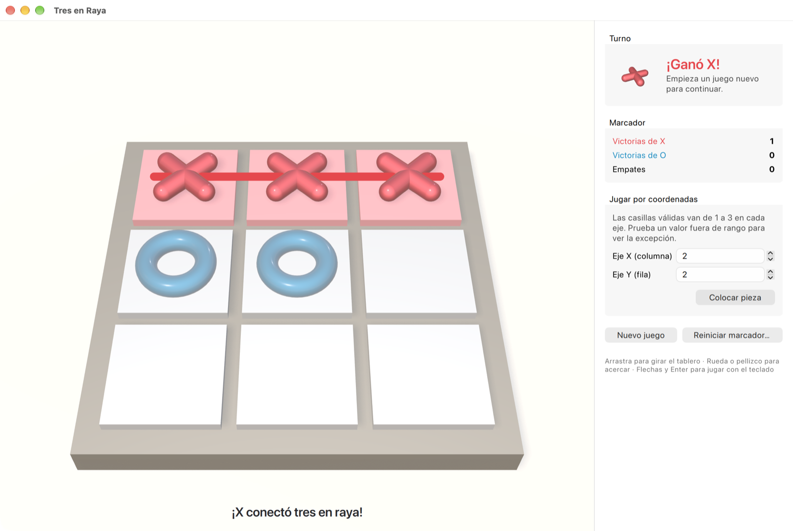
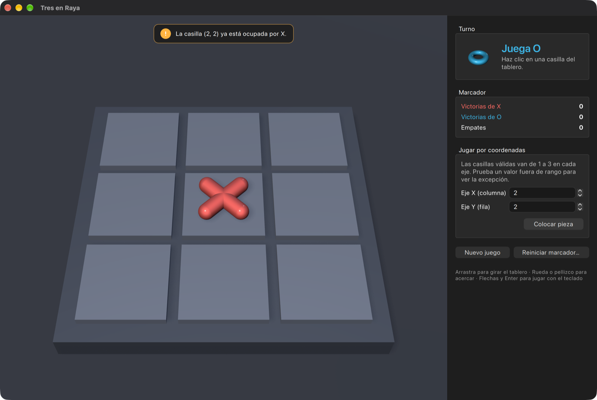

# Tres en Raya — TDD Kata

Aplicación de escritorio en **Qt 6 / C++20** que implementa la *TDD Kata para Tres en Raya*
de la materia **Gestión de Calidad de Sistemas (UCB)**. Toda la lógica del juego se escribió
guiada por pruebas (Qt Test) y la interfaz usa un **tablero en 3D** (Qt Quick 3D) junto con
**controles nativos** de macOS y Windows.

| Modo claro (victoria de X) | Modo oscuro (jugada inválida) |
| --- | --- |
|  |  |

---

## Requerimientos y pruebas (trazabilidad)

Cada prueba de la kata tiene su función de prueba. El nombre de la función describe el
comportamiento y, encima de cada declaración, un comentario cita el requerimiento original.

### Requerimiento 1 — Una pieza puede estar colocada en un espacio de un tablero 3x3

Archivo: [`tests/tictactoe/tst_board_placement.cpp`](tests/tictactoe/tst_board_placement.cpp)

| Prueba de la kata | Función de prueba |
| --- | --- |
| Cuando una pieza está fuera del eje X, se lanza una excepción | `pieceOutsideXAxisThrows` (x = 0, 4, -1) |
| Cuando una pieza está fuera del eje Y, se lanza una excepción | `pieceOutsideYAxisThrows` (y = 0, 4, 10) |
| Cuando una pieza está en un lugar ya ocupado, se lanza una excepción | `pieceOnOccupiedCellThrows` |
| *Complementaria:* toda casilla válida acepta una pieza | `pieceInsideBoardIsPlaced` (las 9 casillas) |
| *Complementaria:* una jugada rechazada no altera la partida | `rejectedMoveDoesNotChangeTheGame` |

### Requerimiento 2 — Debe existir una forma de determinar qué jugador juega después

Archivo: [`tests/tictactoe/tst_turns.cpp`](tests/tictactoe/tst_turns.cpp)

| Prueba de la kata | Función de prueba |
| --- | --- |
| El primer turno siempre debe ser jugado por 'X' | `firstTurnIsPlayedByX` |
| Si el último turno fue de 'X', el siguiente es para 'O' | `afterXComesO` |
| Si el último turno fue de 'O', el siguiente es para 'X' | `afterOComesX` |
| *Complementaria:* los turnos alternan durante toda la partida | `turnsAlternateDuringTheWholeGame` |
| *Complementaria:* reiniciar devuelve el turno a 'X' | `resetGivesTheFirstTurnBackToX` |

### Requerimiento 3 — Gana quien conecta primero una línea de lado a lado o de esquina a esquina

Archivo: [`tests/tictactoe/tst_winner.cpp`](tests/tictactoe/tst_winner.cpp)

| Prueba de la kata | Función de prueba |
| --- | --- |
| Si no se cumple la condición de victoria, no hay ganador | `withoutWinningConditionThereIsNoWinner` |
| Gana con toda una línea horizontal | `wholeHorizontalLineWins` (las 3 filas) |
| Gana con toda una línea vertical | `wholeVerticalLineWins` (las 3 columnas) |
| Gana con toda una línea diagonal | `topLeftToBottomRightDiagonalWins`, `topRightToBottomLeftDiagonalWins` |
| *Complementaria:* 'O' también puede ganar | `oCanAlsoWin` |
| *Complementaria:* tablero lleno sin línea = empate | `fullBoardWithoutLineIsADraw` |
| *Complementaria:* no se puede jugar después de terminar | `noMovesAreAllowedAfterTheGameIsOver` |

### Capa de presentación

[`tests/presentation/tst_gamecontroller.cpp`](tests/presentation/tst_gamecontroller.cpp)
verifica que la interfaz reciba las señales correctas, que las excepciones del dominio se
conviertan en mensajes (nunca llegan a QML) y que el modelo del tablero cumpla el contrato de
Qt (`QAbstractItemModelTester`).

---

## Arquitectura

El proyecto separa el dominio de la interfaz en tres capas, cada una en su propia biblioteca:

```
┌──────────────────────────────────────────────────────────────┐
│ src/app            Vista (QML + Qt Quick 3D + controles nativos)│
│   Main.qml, GamePage.qml, GameBoard3D.qml, Piece3D.qml, ...   │
└───────────────▲──────────────────────────────────────────────┘
                │ propiedades, señales e invocables Qt
┌───────────────┴──────────────────────────────────────────────┐
│ src/presentation   ViewModel (MVVM) — biblioteca + módulo QML  │
│   GameController (QObject), BoardModel (QAbstractListModel)   │
└───────────────▲──────────────────────────────────────────────┘
                │ llamadas C++ directas
┌───────────────┴──────────────────────────────────────────────┐
│ src/core           Dominio — C++20 estándar, sin Qt           │
│   TicTacToe, Board, Player, Position, GameExceptions          │
└──────────────────────────────────────────────────────────────┘
```

- **Dominio puro (`TresEnRaya::Core`)**: no depende de Qt, así que las reglas se prueban sin
  interfaz y se pueden reutilizar.
  - `Board` sólo valida posiciones y ocupación (Req. 1).
  - `TicTacToe` maneja los turnos (Req. 2) y el ganador (Req. 3).
- **Excepciones con datos**: `OutOfBoardException` indica qué eje falló y con qué valor, y
  `OccupiedCellException` qué pieza ocupa la casilla. Todas heredan de
  `InvalidMoveException`. Una jugada inválida no modifica el estado (garantía fuerte).
- **MVVM**: `GameController` traduce las jugadas de la vista al dominio, captura las
  excepciones y las convierte en mensajes traducibles (`tr()`). También lleva el marcador.
- **Vista declarativa**: los componentes QML son pequeños y de una sola responsabilidad
  (`Tile3D`, `Piece3D`, `BoardCell3D`, `WinningBeam3D`, `GameInspector`, `NoticeBanner`).

## Elementos 3D (Qt Quick 3D)

- Tablero con sombras suaves (PCF), iluminación ambiental de un cielo procedural y niebla de
  profundidad, sin archivos de texturas.
- Piezas modeladas en 3D: la **X** son dos cápsulas cruzadas y la **O** un toroide.
- Animaciones: la pieza cae con rebote y giro, desaparece al reiniciar, la línea ganadora
  pulsa con brillo y un haz de luz une las tres piezas.
- Vista previa semitransparente de la pieza del siguiente jugador al pasar el puntero.
- Cámara orbital: arrastrar para girar, rueda o pellizco del trackpad para acercar,
  `Ctrl/⌘ + 0` para restablecerla.
- Vista 3D giratoria de la pieza en turno, en el panel lateral.

## Componentes nativos de macOS y Windows

| Elemento | macOS | Windows |
| --- | --- | --- |
| Controles (botones, SpinBox, GroupBox…) | Estilo `macOS` (dibujado con AppKit) | `FluentWinUI3` en Windows 11, `Windows` en Windows 10 |
| Barra de menús | Integrada en la barra de menús del sistema | Menú de la ventana con estilo nativo |
| Diálogos (`MessageDialog`) | `NSAlert` nativo | Diálogo de Qt Quick con el estilo nativo |
| Preferencias (`Settings`) | `NSUserDefaults` (`bo.edu.ucb.TresEnRaya`) | Registro de Windows |
| Modo claro/oscuro | Sigue al sistema, o se fuerza desde *Ver → Apariencia* | Igual |
| Atajos de teclado | `⌘N`, `⌘0` y `⌘Q` (en el menú de la aplicación) | `Ctrl+N`, `Ctrl+0`; *Juego → Salir* |
| Empaquetado | Bundle `.app` con `Info.plist` e icono `.icns` | Ejecutable con icono `.ico` y `VERSIONINFO` |

El estilo se elige en [`src/app/NativeStyle.cpp`](src/app/NativeStyle.cpp). Para probar otro
sin recompilar, define la variable de entorno `QT_QUICK_CONTROLS_STYLE` (por ejemplo `Fusion`).

## Accesibilidad

- Se puede jugar sólo con el teclado: **flechas** para elegir la casilla, **Enter** o
  **Espacio** para jugar.
- *Jugar por coordenadas* permite escribir X e Y, incluso fuera de rango, para ver en vivo
  la excepción del Requerimiento 1.
- Los avisos usan `Accessible.AlertMessage` y el tablero tiene nombre y descripción
  accesibles.

---

## Requisitos

- **Qt 6.9 o superior** con los módulos *Qt Quick*, *Qt Quick Controls*, *Qt Quick 3D*,
  *Qt Shader Tools* y *Qt Test*. Se desarrolló y probó con Qt 6.12.
- **CMake 3.25+** y **Ninja**.
- Compilador C++20:
  - macOS: Xcode o Command Line Tools.
  - Windows: Visual Studio 2022 (MSVC) o el MinGW que trae el instalador de Qt.

En macOS con Homebrew: `brew install qt cmake ninja`.

## Compilar, probar y ejecutar

### Con Qt Creator

Abre `CMakeLists.txt` y elige un *kit* de Qt 6. Qt Creator detecta `CMakePresets.json` y
muestra las pruebas en el panel *Tests*.

### Desde la terminal

```bash
cmake --preset debug          # configura en build/debug
cmake --build --preset debug  # compila
ctest --preset debug          # ejecuta las pruebas
```

Para ejecutar la aplicación:

```bash
# macOS
open build/debug/src/app/TresEnRaya.app

# Windows
build\debug\src\app\TresEnRaya.exe
```

En Windows, ejecuta los comandos desde *Developer PowerShell for VS 2022* y, si CMake no
encuentra Qt, agrega `-DCMAKE_PREFIX_PATH=C:/Qt/6.x.x/msvc2022_64` al primer comando.

Otros presets:

- `release`: compilación optimizada.
- `ci`: sólo el dominio, la capa de presentación y las pruebas, sin interfaz gráfica.

### Distribuir

```bash
cmake --preset release && cmake --build --preset release
cmake --install build/release --prefix dist
```

La instalación ejecuta el script de despliegue de Qt (`macdeployqt` o `windeployqt`) para
copiar las bibliotecas necesarias.

---

## Buenas prácticas aplicadas

- **TDD**: cada requerimiento de la kata tiene su archivo de pruebas, que especifica el
  comportamiento esperado; el dominio se implementó para satisfacerlas.
- **Pruebas legibles**: estructura *Arrange / Act / Assert*, pruebas con datos
  (`_data()` + `QFETCH`) para cubrir variantes sin duplicar código, `init()` para aislar
  cada caso, y `QSignalSpy` y `QAbstractItemModelTester` para la capa Qt.
- **SOLID**:
  - Responsabilidad única: `Board` frente a `TicTacToe`, y componentes QML pequeños.
  - Dependencias hacia el dominio: el núcleo no conoce a Qt.
- **Seguridad de tipos**: `enum class` para jugadores, ejes y estados; `std::optional` para
  "sin pieza" o "sin ganador"; `[[nodiscard]]`, `constexpr` y `noexcept` donde corresponde.
- **Compilación estricta**:
  - GCC/Clang: `-Wall -Wextra -Wpedantic -Wconversion -Wshadow -Wold-style-cast …` con
    `-Werror`.
  - MSVC: `/W4 /permissive- /WX`.
- **QML tipado y verificado**:
  - `required property`, funciones con tipos y `pragma ComponentBehavior: Bound`.
  - Módulos declarados con `qt_add_qml_module`, compilados con `qmlcachegen` y revisados
    con `qmllint` (`cmake --build --preset debug --target all_qmllint`) sin advertencias.
- **CMake moderno**:
  - Objetivos con alias (`TresEnRaya::Core`, `TresEnRaya::Presentation`) y dependencias
    `PUBLIC`/`PRIVATE` explícitas.
  - Presets compartidos y reglas de instalación y despliegue.
- **Estilo uniforme**: `.clang-format` (estilo Qt) y `.editorconfig`.

## Estructura

```
tres-en-raya/
├── CMakeLists.txt              Proyecto raíz (opciones, Qt, subdirectorios)
├── CMakePresets.json           Presets debug / release / ci
├── cmake/CompilerWarnings.cmake
├── src/
│   ├── core/                   Dominio en C++20 puro
│   │   ├── include/tresenraya/tictactoe/*.h
│   │   └── src/tictactoe/*.cpp
│   ├── presentation/           ViewModels Qt (módulo QML TresEnRaya.Presentation)
│   └── app/                    Ejecutable, QML, recursos e integración con cada SO
│       ├── qml/                Vista y escena 3D
│       ├── resources/          Icono SVG
│       └── platform/           Info.plist + .icns (macOS), .rc + .ico (Windows)
├── tests/
│   ├── tictactoe/              Pruebas de la kata (Req. 1, 2 y 3)
│   └── presentation/           Pruebas del ViewModel
└── docs/                       Capturas de pantalla
```
